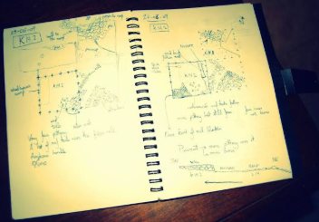
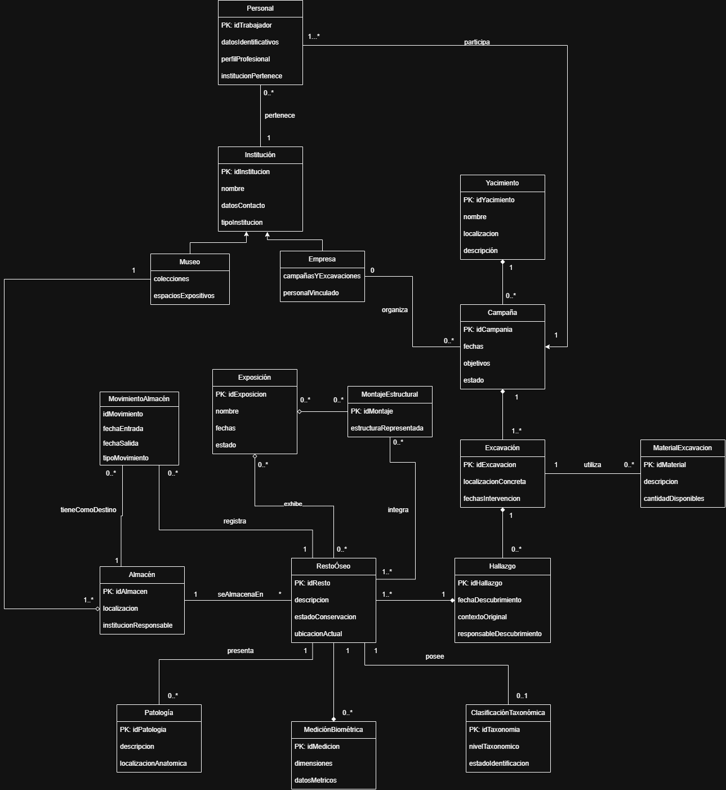

# Título Proyecto

## Miembros del grupo L5-AM-2

1. Morales Márquez, Diego
2. Cabeza Curado, Hugo
3. Muñoz Pereira, Jesús
4. Morrondo Silva, Alejandro

## 1. Introducción al problema
El principal inconveniente a día de hoy en el ámbito de la arqueología se centra en la descentralización e inconsistencia en los formatos y criterios de registro de datos entre las distintas expediciones arqueológicas. La mayoría de expediciones no siguen una estructura definida debido a que muchas veces los datos se registran en cuadernos, ordenadores locales u hojas de cálculo resultando en derivaciones además del problema principal:

- Pérdida de seguimiento de los hallazgos: es complicado manejar y rastrear todo el recorrido que sufre una pieza desde su extracción hasta su destino final como puede ser un instituto público (museos o universidades) o almacenes.

- Desconexión entre personal y actividades: no existe un registro que dicte los diferentes tipos de trabajadores que participaron así como el  rol que desempeñaron en la expedición y las hazañas específicas logradas.

- Ineficiencia en el análisis: los restos óseos que se descubren requieren una descripción y clasificación detallada que la mayoría de las veces se resumen de forma excesiva y estas se pierden.
 
- Falta de información en museos: los museos reciben piezas con falta de información que no se ofrece ni es consultable haciendo esa información “invisible” al resto de los visitantes interesados.

Por ello, diversas empresas y museos necesitan centralizar sus datos para comprender mejor los hallazgos y profundizar en nuestro pasado. Con el objetivo de dar respuesta a esta necesidad, planteamos una base de datos accesible para clientes y usuarios que garantice la consistencia de la información y evite la pérdida del trabajo invertido.

<table>
  <tr>
    <td width="250">

    </td>
    <td>
      

       Falta de información en el museo: Las cartelas solo muestran datos básicos como la fecha o el material. Al no haber un registro digital desde la excavación, se pierde la historia completa de la pieza: quién la descubrió, cómo se halló y su contexto original.
      

     </td>
  </tr>
</table>

<table>
  <tr>
    <td>
      

       Cuadernos y códigos propios: Usar notas a mano y nomenclaturas personales hace que los datos solo los entienda quien los escribió. Sin un sistema común, es casi imposible cruzar esa información con el trabajo del resto del equipo.
      

     </td> 
   <td width="250">

    </td>
   
  </tr>
</table>

# 2. Glosario de términos

### B
- **Bitácora:** Registro de información y observaciones relacionadas con el desarrollo de una excavación o con un hallazgo.

### C
- **Clasificación taxonómica:** Asignación de un resto fósil a una categoría biológica, como familia, género o especie.
- **Contexto original:** Información sobre las circunstancias geológicas, estratigráficas y ambientales en las que se encontró un fósil.

### D
- **Degradación:** Proceso por el que un fósil pierde calidad, estabilidad o integridad debido a factores físicos, químicos o biológicos.

### E
- **Estado de conservación:** Condición física en la que se encuentra un fósil, incluyendo posibles fracturas, erosión o deformaciones.
- **Estado de identificación:** Situación de una clasificación taxonómica, que puede ser provisional o confirmada.
- **Estrato:** Capa diferenciada del terreno en la que puede localizarse un hallazgo.

### M
- **Medición biométrica:** Registro de las dimensiones y características físicas de un resto fósil.
- **Montaje estructural:** Composición de varios restos fósiles para representar una estructura anatómica o un organismo.
- **Museografía:** Disciplina relacionada con el diseño, la organización y la presentación de colecciones y exposiciones en museos.

### P
- **Patología:** Alteración o lesión observable en un resto fósil que puede aportar información sobre enfermedades, traumatismos o anomalías.

### R
- **Resto óseo:** Hueso o fragmento de hueso conservado de un organismo, que puede constituir un fósil.

### T
- **Trazabilidad:** Capacidad de conocer la procedencia, los movimientos, los tratamientos y la ubicación de un fósil durante su historial.
- **Taxonomía:** Disciplina científica que identifica, nombra y clasifica los seres vivos en grupos jerárquicos.

# 3. Visión general del sistema

## 3.1. Requisitos generales

El sistema tiene como finalidad centralizar y gestionar la información relacionada con las instituciones, el personal, los yacimientos y las actividades paleontológicas, permitiendo mantener un registro completo de los hallazgos desde su descubrimiento hasta su conservación, análisis y posible exposición pública.

Los requisitos generales del sistema se describen mediante las siguientes historias de usuario:

**R.G.01. Gestión de instituciones**

Como administrador de la base de datos, quiero gestionar la información de museos y empresas, incluyendo sus identificadores, nombres, datos de contacto y tipo de institución, para mantener un registro organizado de las entidades que participan en las actividades paleontológicas.

**R.G.02. Gestión de yacimientos**

Como paleontólogo de campo, quiero gestionar los yacimientos paleontológicos, incluyendo su identificador, nombre, localización geográfica y descripción geológica, para disponer de información centralizada sobre los lugares de investigación y excavación.

**R.G.03. Gestión de campañas y excavaciones**

Como paleontólogo de campo, quiero gestionar las campañas asociadas a cada yacimiento, incluyendo sus fechas, objetivos y estado, así como las excavaciones que se realizan dentro de ellas, para organizar y documentar las intervenciones de campo.

**R.G.04. Gestión de hallazgos**

Como paleontólogo de campo, quiero registrar y consultar los hallazgos realizados durante las excavaciones, incluyendo su fecha de descubrimiento, contexto original y responsable, para conservar la información sobre las circunstancias de cada descubrimiento.

**R.G.05. Gestión del personal**

Como administrador de la base de datos, quiero gestionar los datos identificativos, perfiles profesionales e instituciones de pertenencia del personal, para controlar los usuarios del sistema y sus funciones en las actividades paleontológicas.

**R.G.06. Gestión de recursos de excavación**

Como paleontólogo de campo, quiero consultar y gestionar los materiales y herramientas utilizados durante las excavaciones, incluyendo su descripción y cantidad disponible, para controlar los recursos empleados en las intervenciones.

**R.G.07. Gestión del catálogo de restos**

Como conservador de colecciones, quiero gestionar los restos óseos procedentes de los hallazgos, incluyendo su número de catálogo, descripción, estado de conservación y ubicación actual, para mantener un catálogo completo y garantizar su identificación y seguimiento.

**R.G.08. Gestión de análisis científicos**

Como investigador científico, quiero gestionar las clasificaciones taxonómicas, patologías y mediciones biométricas asociadas a los restos, incluyendo sus niveles de identificación, descripciones, localizaciones anatómicas y datos métricos, para documentar sus características científicas.

**R.G.09. Gestión de almacenes y movimientos**

Como conservador de colecciones, quiero gestionar los almacenes y registrar los movimientos de entrada, salida y traslado de los restos fósiles, incluyendo sus fechas y tipos de movimiento, para conocer su ubicación vigente y mantener su historial de custodia.

**R.G.10. Gestión de exposiciones y montajes**

Como museógrafo, quiero gestionar las exposiciones, incluyendo su nombre, fechas, estado, restos exhibidos y montajes estructurales asociados, para organizar la presentación pública de las colecciones paleontológicas.

**R.G.11. Consulta de información paleontológica**

Como usuario del sistema, quiero realizar consultas sobre yacimientos, campañas, hallazgos, restos fósiles, instituciones y exposiciones mediante diferentes criterios de búsqueda, para obtener información específica y facilitar el acceso al conocimiento paleontológico.

## 3.2. Usuarios del sistema

- **Paleontólogo de campo:** Gestiona la información de yacimientos, campañas, excavaciones y hallazgos, además de consultar el personal participante y los materiales empleados.
- **Preparador paleontólogo:** Registra y consulta información relacionada con la preparación y el análisis inicial de los restos fósiles.
- **Conservador de colecciones:** Gestiona la catalogación, conservación, ubicación y movimientos de los restos fósiles.
- **Investigador científico:** Consulta y registra clasificaciones taxonómicas, patologías, mediciones biométricas y documentación científica.
- **Museógrafo:** Gestiona exposiciones, selecciona los restos que se exhiben y organiza los montajes estructurales.
- **Administrador de la base de datos:** Gestiona los usuarios, las instituciones, los permisos y el mantenimiento de la base de datos.

# 4. Catálogo de requisitos

## 4.1. Requisitos funcionales

### Gestión de yacimientos y campañas

**R.F.01. Consulta de yacimientos**

Como paleontólogo de campo, quiero consultar los yacimientos registrados, incluyendo su identificador, nombre, localización geográfica, descripción y las campañas y excavaciones asociadas, para conocer sus características y las actividades realizadas en ellos.

**R.F.02. Consulta de campañas de excavación**

Como paleontólogo de campo, quiero consultar las campañas registradas, incluyendo su identificador, fechas de inicio y finalización, objetivos, estado, yacimiento asociado y personal participante, para conocer la planificación y el desarrollo de los trabajos.

**R.F.03. Consulta del personal participante**

Como paleontólogo de campo, quiero consultar los profesionales que han participado en un yacimiento, campaña o excavación, incluyendo sus datos identificativos, perfil profesional y función desempeñada, para conocer los integrantes de los equipos de trabajo.

### Gestión de hallazgos y restos

**R.F.04. Consulta de hallazgos**

Como paleontólogo de campo, quiero consultar los hallazgos registrados, incluyendo su identificador, fecha de descubrimiento, contexto original, responsable y excavación de procedencia, para conocer las evidencias localizadas durante las intervenciones.

**R.F.05. Consulta de la procedencia de los hallazgos**

Como conservador de colecciones, quiero consultar la procedencia de un hallazgo, incluyendo su yacimiento, campaña, excavación y contexto original, para conocer las circunstancias geográficas y estratigráficas de su descubrimiento.

**R.F.06. Consulta de la información del descubrimiento**

Como investigador científico, quiero consultar la fecha de descubrimiento, el responsable, las observaciones y el contexto geológico y estratigráfico de un hallazgo, para estudiar las circunstancias en las que se localizó una pieza.

**R.F.07. Consulta de restos óseos**

Como preparador paleontólogo, quiero consultar los restos óseos catalogados, incluyendo su identificador, número de catálogo, descripción, estado de conservación, ubicación actual, hallazgo de procedencia y datos científicos asociados, para conocer sus características y su situación actual.

**R.F.08. Consulta de la clasificación taxonómica**

Como investigador científico, quiero consultar la clasificación taxonómica de los restos, incluyendo los niveles de familia, género y especie y el estado de identificación, para conocer el grupo biológico al que pertenecen y diferenciar las identificaciones provisionales de las confirmadas.

**R.F.09. Consulta de patologías y mediciones biométricas**

Como investigador científico, quiero consultar las patologías y mediciones biométricas de los restos, incluyendo las descripciones de las lesiones, sus localizaciones anatómicas, dimensiones y datos métricos asociados, para estudiar sus características morfológicas y posibles alteraciones.

### Gestión de instituciones y almacenes

**R.F.10. Consulta de museos**

Como usuario del sistema, quiero consultar los museos registrados, incluyendo su identificador, nombre, datos de contacto, colecciones y espacios expositivos, para conocer las instituciones que custodian y exponen restos paleontológicos.

**R.F.11. Consulta de almacenes**

Como conservador de colecciones, quiero consultar los almacenes registrados, incluyendo su identificador, localización, institución responsable y restos custodiados, para conocer los espacios destinados a la conservación de las colecciones.

**R.F.12. Consulta de empresas**

Como usuario del sistema, quiero consultar las empresas registradas, incluyendo su identificador, nombre, datos de contacto, campañas organizadas y personal vinculado, para conocer las entidades que participan en las actividades paleontológicas.

### Gestión de excavaciones

**R.F.13. Consulta de excavaciones**

Como paleontólogo de campo, quiero consultar las excavaciones registradas, incluyendo su identificador, localización concreta, fechas de intervención, campaña asociada y hallazgos obtenidos, para conocer las intervenciones realizadas en cada yacimiento.

**R.F.14. Consulta de materiales de excavación**

Como paleontólogo de campo, quiero consultar los materiales y herramientas utilizados en las excavaciones, incluyendo su identificador, descripción y cantidad disponible, para conocer los recursos empleados durante las intervenciones.

**R.F.15. Consulta de trabajadores de las excavaciones**

Como usuario del sistema, quiero consultar los trabajadores vinculados a una excavación, incluyendo sus datos identificativos, perfil profesional y función desempeñada, para conocer quiénes participaron en cada intervención.

### Gestión del personal

**R.F.16. Consulta de datos del personal**

Como administrador de la base de datos, quiero consultar los datos identificativos y profesionales del personal registrado, incluyendo su identificador, nombre, apellidos, perfil profesional e institución de pertenencia, para gestionar los usuarios y sus vinculaciones.

**R.F.17. Consulta de instituciones y centros de trabajo**

Como usuario del sistema, quiero consultar las instituciones a las que pertenece el personal, incluyendo sus datos identificativos y tipo de institución, para conocer la vinculación profesional de los trabajadores.

### Gestión de exposiciones

**R.F.18. Consulta de exposiciones**

Como museógrafo, quiero consultar las exposiciones registradas, incluyendo su identificador, nombre, fechas, estado, restos exhibidos y montajes estructurales asociados, para conocer su contenido y organización.

**R.F.19. Consulta de los lugares de exposición**

Como museógrafo, quiero consultar los espacios expositivos asociados a los museos y sus exposiciones, incluyendo la sala, el edificio y la localización correspondiente, para conocer dónde se encuentran expuestas las colecciones.

**R.F.20. Consulta del estado de las exposiciones**

Como usuario del sistema, quiero consultar el estado de las exposiciones y sus fechas de inicio y finalización, para conocer si se encuentran planificadas, activas, finalizadas o suspendidas.

### Consultas específicas

**R.F.21. Consulta de dinosaurios por procedencia geográfica**

Como investigador científico, quiero consultar los restos fósiles identificados como dinosaurios encontrados en un país o región determinada, utilizando la clasificación taxonómica y la localización de sus yacimientos de procedencia, para estudiar su distribución geográfica.

**R.F.22. Consulta del número de fósiles por museo**

Como conservador de colecciones, quiero consultar el número total de restos fósiles custodiados por cada museo, teniendo en cuenta sus almacenes y las ubicaciones vigentes de los restos, para conocer el volumen de sus colecciones.

**R.F.23. Consulta de restos por especie**

Como investigador científico, quiero consultar todos los restos fósiles asociados a una especie determinada, incluyendo sus números de catálogo, procedencias y estados de conservación, para comparar los ejemplares identificados.

**R.F.24. Consulta de hallazgos por yacimiento y periodo**

Como paleontólogo de campo, quiero consultar los hallazgos registrados en un yacimiento durante un intervalo de fechas determinado, incluyendo su fecha de descubrimiento y excavación de procedencia, para analizar los resultados de las intervenciones.

**R.F.25. Consulta de restos por exposición**

Como museógrafo, quiero consultar los restos fósiles que forman parte de una exposición determinada, incluyendo sus números de catálogo y montajes estructurales asociados, para conocer el contenido de cada muestra.

**R.F.26. Consulta del historial de movimientos de un resto**

Como conservador de colecciones, quiero consultar los movimientos registrados de un resto fósil, incluyendo su fecha de entrada, fecha de salida, tipo de movimiento y almacén de origen o destino, para conocer su historial de custodia.

## 4.1.1. Requisitos de información

### R.I.01. Información de los yacimientos

Como paleontólogo de campo, quiero consultar y almacenar la información identificativa y geográfica de los yacimientos, para conocer sus características y localización.

Los atributos que se deben almacenar son:

- `idYacimiento`: Identificador único del yacimiento.
- `nombre`: Nombre asignado al yacimiento.
- `localizacion`: Coordenadas geográficas, región o ubicación física.
- `descripcion`: Características geológicas y estratigráficas del lugar.

### R.I.02. Información de campañas y excavaciones

Como paleontólogo de campo, quiero consultar y almacenar la información de las campañas y excavaciones, para documentar las intervenciones realizadas.

Los atributos de Campaña son:

- `idCampana`: Identificador único de la campaña.
- `fechas`: Fecha de inicio y fecha de finalización.
- `objetivos`: Metas científicas de la campaña.
- `estado`: Situación actual de la campaña.

Los atributos de Excavación son:

- `idExcavacion`: Identificador único de la excavación.
- `localizacionConcreta`: Sector, cuadrícula o punto de intervención.
- `fechasIntervencion`: Fechas en las que se realizaron los trabajos.

### R.I.03. Información de hallazgos y restos fósiles

Como conservador de colecciones, quiero consultar y almacenar los datos identificativos y descriptivos de los hallazgos y restos fósiles, para realizar su seguimiento desde el descubrimiento hasta su ubicación actual.

Los atributos de Hallazgo son:

- `idHallazgo`: Identificador único del hallazgo.
- `fechaDescubrimiento`: Fecha y hora aproximada del descubrimiento.
- `contextoOriginal`: Circunstancias geológicas y estratigráficas.
- `responsableDescubrimiento`: Personal o equipo responsable del descubrimiento.

Los atributos de RestoÓseo son:

- `idResto`: Identificador único del resto.
- `descripcion`: Descripción morfológica y física.
- `estadoConservacion`: Condición física del resto.
- `ubicacionActual`: Ubicación vigente del resto.
- `numeroCatalogo`: Código alfanumérico asignado a la pieza.

### R.I.04. Información científica y taxonómica

Como investigador científico, quiero consultar y almacenar los datos taxonómicos, morfológicos y patológicos de los restos, para estudiar sus características científicas.

Los atributos de ClasificaciónTaxonómica son:

- `idTaxonomia`: Identificador de la clasificación.
- `nivelTaxonomico`: Nivel biológico asignado, como familia, género o especie.
- `estadoIdentificacion`: Indica si la identificación es provisional o confirmada.

Los atributos de Patología son:

- `idPatologia`: Identificador de la patología.
- `descripcion`: Descripción de la alteración o lesión.
- `localizacionAnatomica`: Parte del hueso donde se encuentra.

Los atributos de MediciónBiométrica son:

- `idMedicion`: Identificador de la medición.
- `dimensiones`: Valores de longitud, anchura, grosor y otras dimensiones.
- `datosMetricos`: Archivos, escaneos 3D y tablas métricas asociadas.

### R.I.05. Información de instituciones y personal

Como administrador de la base de datos, quiero consultar y almacenar la información de las instituciones y del personal vinculado, para conocer sus datos identificativos y profesionales.

Los atributos de Institución son:

- `idInstitucion`: Identificador único.
- `nombre`: Denominación oficial de la institución.
- `datosContacto`: Información de contacto y localización.
- `tipoInstitucion`: Tipo de entidad, como museo o empresa.

Los atributos específicos de Museo son:

- `colecciones`: Fondos y colecciones científicas custodiadas.
- `espaciosExpositivos`: Salas y espacios destinados a exposiciones.

Los atributos específicos de Empresa son:

- `campañasYExcavaciones`: Actividades organizadas o financiadas.
- `personalVinculado`: Profesionales asociados a la empresa.

Los atributos de Personal son:

- `idTrabajador`: Identificador único del trabajador.
- `datosIdentificativos`: Nombre, apellidos y credenciales de acceso.
- `perfilProfesional`: Rol profesional desempeñado.
- `institucionPertenece`: Institución de adscripción.

### R.I.06. Información de recursos de excavación

Como paleontólogo de campo, quiero consultar y almacenar los datos de los materiales empleados en las excavaciones, para controlar los recursos disponibles.

Los atributos de MaterialExcavación son:

- `idMaterial`: Identificador único del material.
- `descripcion`: Tipo de herramienta, equipo o recurso.
- `cantidadDisponibles`: Número de unidades disponibles.

### R.I.07. Información de almacenes y movimientos

Como conservador de colecciones, quiero consultar y almacenar la información de los almacenes y los movimientos de los restos fósiles, para conocer su ubicación y mantener un historial de custodia.

Los atributos de Almacén son:

- `idAlmacen`: Identificador único del almacén.
- `localizacion`: Dirección o ubicación física.
- `institucionResponsable`: Institución responsable de su gestión.

Los atributos de MovimientoAlmacén son:

- `idMovimiento`: Identificador único del movimiento.
- `fechaEntrada`: Fecha de entrada del resto en el almacén.
- `fechaSalida`: Fecha de salida del resto.
- `tipoMovimiento`: Tipo de movimiento realizado.

### R.I.08. Información de exposiciones y montajes

Como museógrafo, quiero consultar y almacenar los datos de las exposiciones y los montajes estructurales, para conocer la planificación y el contenido de las muestras.

Los atributos de Exposición son:

- `idExposicion`: Identificador único de la exposición.
- `nombre`: Denominación de la exposición.
- `fechas`: Fechas de inicio y finalización.
- `estado`: Situación actual de la exposición.

Los atributos de MontajeEstructural son:

- `idMontaje`: Identificador único del montaje.
- `estructuraRepresentada`: Descripción de la estructura anatómica representada.

## 4.1.2. Reglas de negocio

### R.N.01. Identificación única de registros

Cada entidad registrada en el sistema debe disponer de un identificador único que permita distinguirla de las demás entidades del mismo tipo.

**Pruebas de aceptación:**
- No se permitirá registrar dos entidades del mismo tipo con el mismo identificador.
- Cada nuevo registro deberá disponer de un identificador válido.
- Los identificadores de los registros existentes no podrán modificarse de manera que provoquen duplicidades.

### R.N.02. Coherencia temporal de campañas y excavaciones

Las fechas de las campañas y excavaciones deben respetar una secuencia temporal coherente con el desarrollo de las actividades paleontológicas.

**Pruebas de aceptación:**
- La fecha de finalización de una campaña no podrá ser anterior a su fecha de inicio.
- Las fechas de intervención de una excavación deberán encontrarse dentro del periodo de su campaña asociada.
- No se permitirá registrar intervenciones con fechas incompatibles con el periodo de la campaña.

### R.N.03. Coherencia temporal de los hallazgos

La fecha de descubrimiento de un hallazgo debe ser compatible con el periodo en el que se desarrolló la excavación correspondiente.

**Pruebas de aceptación:**
- La fecha de descubrimiento no podrá ser anterior al inicio de la campaña en la que se produjo.
- La fecha de descubrimiento no podrá ser posterior a la finalización de la intervención correspondiente.
- No se admitirán fechas de descubrimiento futuras.

### R.N.04. Identificación y catalogación de restos fósiles

Cada resto óseo catalogado debe disponer de un número de catálogo único dentro del sistema, que permita identificarlo de forma individual.

**Pruebas de aceptación:**
- No se permitirá asignar el mismo número de catálogo a dos restos diferentes.
- Todo resto catalogado deberá disponer de un número de catálogo válido.
- La información científica y descriptiva deberá quedar asociada al resto correspondiente.

### R.N.05. Consistencia de la clasificación científica

Las clasificaciones taxonómicas deben reflejar correctamente su estado de identificación y diferenciar las identificaciones provisionales de las confirmadas.

**Pruebas de aceptación:**
- Una clasificación provisional deberá mostrarse como provisional.
- Una clasificación confirmada deberá mostrarse como confirmada únicamente cuando su estado de identificación así lo indique.
- No se permitirá establecer un estado de identificación diferente de los valores contemplados por el sistema.

### R.N.06. Coherencia de los movimientos y ubicaciones

Los movimientos de los restos fósiles deben mantener una secuencia temporal coherente y permitir conocer su ubicación vigente.

**Pruebas de aceptación:**
- La fecha de salida de un almacén no podrá ser anterior a la fecha de entrada.
- No se permitirá registrar dos ubicaciones vigentes simultáneas para un mismo resto.
- Un resto no podrá registrar una nueva entrada en un almacén si todavía figura como custodiado en otro.
- El historial de movimientos anteriores deberá conservarse aunque cambie la ubicación actual.

### R.N.07. Control de acceso a la información

Cada usuario únicamente podrá acceder a las operaciones y datos autorizados según su perfil profesional.

**Pruebas de aceptación:**
- Un usuario sin permisos de administración no podrá realizar operaciones reservadas al administrador de la base de datos.
- Los paleontólogos de campo podrán gestionar la información correspondiente a yacimientos, campañas, excavaciones y hallazgos.
- Los preparadores podrán acceder a las operaciones de preparación y análisis de los restos.
- Los conservadores podrán gestionar la catalogación, conservación y movimientos de los restos.
- Los investigadores podrán gestionar la información científica y biométrica.
- Los museógrafos podrán gestionar las exposiciones y los montajes estructurales.
- Un usuario no autorizado no podrá modificar ni consultar información restringida.

### R.N.08. Coherencia temporal de las exposiciones

Las fechas y estados de las exposiciones deben ser coherentes con su planificación y desarrollo.

**Pruebas de aceptación:**
- La fecha de finalización no podrá ser anterior a la fecha de inicio.
- Una exposición no podrá figurar como activa antes de su fecha de inicio.
- Una exposición no podrá figurar como finalizada antes de su fecha de cierre.
- Los estados permitidos serán planificada, activa, finalizada y suspendida.
- Una exposición suspendida deberá conservar sus fechas y datos de planificación.

### R.N.09. Coherencia de las mediciones biométricas

Las mediciones biométricas deben contener valores válidos y representar correctamente las dimensiones del resto analizado.

**Pruebas de aceptación:**
- Las dimensiones registradas deberán ser valores numéricos positivos.
- No se permitirán dimensiones negativas o iguales a cero.
- Los datos métricos adjuntos deberán corresponder al resto sobre el que se ha realizado el análisis.

### R.N.10. Coherencia de las cantidades de materiales

Las cantidades disponibles de los materiales empleados en las excavaciones deben representar valores válidos de inventario.

**Pruebas de aceptación:**
- La cantidad disponible no podrá ser negativa.
- No se permitirán cantidades fraccionarias cuando el material se contabilice en unidades individuales.
- Las operaciones de actualización del inventario deberán mantener una cantidad válida.

### R.N.11. Coherencia de los datos de identificación profesional

Los datos identificativos y las credenciales del personal deberán cumplir las condiciones establecidas para la identificación y autenticación de los usuarios.

**Pruebas de aceptación:**
- Los datos obligatorios de identificación deberán estar cumplimentados.
- No se permitirán credenciales de acceso vacías.
- Cada cuenta deberá disponer de un perfil profesional válido.

## 4.2. Mapa de historias de usuario

El siguiente mapa relaciona las funcionalidades principales del sistema con los códigos de sus respectivos requisitos funcionales.

### GESTIÓN DE YACIMIENTOS

- Consultar yacimientos registrados — **R.F.01**
- Consultar campañas de excavación — **R.F.02**
- Consultar personal participante — **R.F.03**
- Consultar excavaciones de un yacimiento — **R.F.01**
- Consultar hallazgos por yacimiento y periodo — **R.F.24**

### GESTIÓN DE HALLAZGOS

- Consultar hallazgos registrados — **R.F.04**
- Consultar procedencia de los hallazgos — **R.F.05**
- Consultar información del descubrimiento — **R.F.06**

### CATÁLOGO DE RESTOS FÓSILES

- Consultar restos óseos catalogados — **R.F.07**
- Consultar clasificación taxonómica — **R.F.08**
- Consultar patologías y mediciones biométricas — **R.F.09**
- Consultar restos por especie — **R.F.23**
- Consultar dinosaurios por país o región — **R.F.21**

### GESTIÓN DE MUSEOS Y EMPRESAS

- Consultar museos registrados — **R.F.10**
- Consultar almacenes — **R.F.11**
- Consultar empresas registradas — **R.F.12**
- Consultar número de fósiles por museo — **R.F.22**

### GESTIÓN DE EXCAVACIONES

- Consultar excavaciones — **R.F.13**
- Consultar materiales de excavación — **R.F.14**
- Consultar trabajadores participantes — **R.F.15**

### GESTIÓN DEL PERSONAL

- Consultar datos del personal — **R.F.16**
- Consultar instituciones de pertenencia — **R.F.17**

### GESTIÓN DE EXPOSICIONES

- Consultar exposiciones — **R.F.18**
- Consultar lugares de exposición — **R.F.19**
- Consultar estado de las exposiciones — **R.F.20**
- Consultar restos incluidos en una exposición — **R.F.25**
- Consultar montajes estructurales asociados — **R.F.18**

## 4.3. Requisitos no funcionales

### R.N.F.01. Usabilidad

Como usuario del sistema, quiero disponer de una interfaz clara e intuitiva, para consultar y gestionar la información sin necesitar conocimientos técnicos avanzados.

### R.N.F.02. Rendimiento

Como usuario del sistema, quiero que las consultas y operaciones devuelvan resultados en un tiempo razonable, para trabajar de forma eficiente.

### R.N.F.03. Seguridad

Como administrador de la base de datos, quiero que el acceso a la información esté protegido mediante mecanismos de autenticación y autorización, para evitar accesos y modificaciones no permitidos.

### R.N.F.04. Disponibilidad

Como usuario autorizado, quiero poder acceder al sistema cuando lo necesite, para consultar la información necesaria para mi trabajo.

### R.N.F.05. Integridad y conservación de los datos

Como administrador de la base de datos, quiero que la información se almacene de forma consistente y disponga de mecanismos de copia de seguridad, para reducir el riesgo de pérdida o corrupción de información.

### R.N.F.06. Mantenibilidad

Como administrador de la base de datos, quiero que la estructura del sistema permita realizar modificaciones y ampliaciones de forma organizada, para facilitar su mantenimiento y evolución.

### R.N.F.07. Escalabilidad

Como administrador de la base de datos, quiero que el sistema pueda admitir un incremento del número de instituciones, usuarios, yacimientos y restos registrados, para permitir su crecimiento sin afectar significativamente a su funcionamiento.

-- fin entregable 1 --

## 5. Modelo conceptual

### 5.1. Diagramas de clases UML

- con restricciones.

### 5.2. Escenarios de prueba

- con descripción textual y diagrama de objetos UML.

## 6. Matrices de trazabilidad

- Matriz de trazabilidad entre los elementos del modelo conceptual y los requisitos.

|       | EntidadX   | AsociaciónX  | RestricciónX  | Entidad2 ...   | 
|:------|:-----------|:-----------|:-----------|:-----------|
| RI-1  | X          | X          | X          | X          |
| RI-2  |            | X          |            | X          |
| RF-1  |            | X          |            | X          |
| RF-2  | X          |            | X          | X          |
| RN-1  |            | X          |            |            |
| RN-2  | X          | X          | X          |            |
| ...   |            |            |            |            |

-- fin entregable 2 --

## 7. Modelo relacional en 3FN

- Relaciones obtenidas al aplicar la transformación del modelo conceptual.

### 7.1.  Justificación de la estrategia de transformación de jerarquías

- si se identificaron jerarquías en el MC.

### 8. Matriz de trazabilidad MC/SQL (opcional):

- Restricciones sobre el MC / Elementos del modelo tecnológico (SQL) (Triggers, checks, etc.)
- Incluir Reglas de negocio — Constraints/Triggers en las matrices de trazabilidad para el entregable 3

|       | EntidadX   | AsociaciónX  | RestricciónX  | Entidad2 ...   | 
|:-------|:-------|:-------|:-------|:-------|
| TABLA-1 |        |        |        |        |
| TABLA-2 |        |        |        |        |
| TABLA-3 |        |        |        |        |
| TABLA-4 |        |        |        |        |
| TRIG-1 |        |        |        |        |
| TRIG-2 | X      | X      |        | X      |
| TRIG-3 |        | X      |        | X      |
| TRIG-4 |        |        | X      |        |
| CONST-1 |        |        |        |        |
| CONST-2 | X      | X      |        | X      |
| CONST-3 |        | X      |        | X      |
| CONST-4 |        |        | X      |        |

Se consideran todo tipo de constraints declarativas (aquellas definidas durante el CREATE TABLE).
-- fin entregable 3 --

## Referencias

