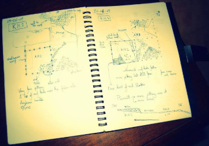

# Título Proyecto

## Miembros del grupo LX-XXX-X (sustituir)

1. Morales Márquez, Diego
2. Cabeza Curado, Hugo
3. Muñoz Pereira, Jesús
4. Morrondo Silva, Alejandro

## 1. Introducción al problema
El principal inconveniente a día de hoy en el ámbito de la arqueología se centra en la descentralización e inconsistencia en los formatos y criterios de registro de datos entre las distintas expediciones arqueológicas. La mayoría de expediciones no siguen una estructura definida debido a que muchas veces los datos se registran en cuadernos, ordenadores locales u hojas de cálculo resultando en derivaciones además del problema principal:

- Pérdida de seguimiento de los hallazgos: es complicado manejar y rastrear todo el recorrido que sufre una pieza desde su extracción hasta su destino final como puede ser un instituto público (museos o universidades) o almacenes.

- Desconexión entre personal y actividades: no existe un registro que dicte los diferentes tipos de trabajadores que participaron así como el  rol que desempeñaron en la expedición y las hazañas específicas logradas.

- Ineficiencia en el análisis: los restos óseos que se descubren requieren una descripción y clasificación detallada que la mayoría de las veces se resumen de forma excesiva y estas se pierden.
 
- Falta de información en museos: los museos reciben piezas con falta de información que no se ofrece ni es consultable haciendo esa información “invisible” al resto de los visitantes interesados.

Por ello, diversas empresas y museos necesitan centralizar sus datos para comprender mejor los hallazgos y profundizar en nuestro pasado. Con el objetivo de dar respuesta a esta necesidad, planteamos una base de datos accesible para clientes y usuarios que garantice la consistencia de la información y evite la pérdida del trabajo invertido.

<table>
  <tr>
    <td width="250">

    </td>
    <td>
      

       Falta de información en el museo: Las cartelas solo muestran datos básicos como la fecha o el material. Al no haber un registro digital desde la excavación, se pierde la historia completa de la pieza: quién la descubrió, cómo se halló y su contexto original.
      

     </td>
  </tr>
</table>

<table>
  <tr>
    <td>
      

       Cuadernos y códigos propios: Usar notas a mano y nomenclaturas personales hace que los datos solo los entienda quien los escribió. Sin un sistema común, es casi imposible cruzar esa información con el trabajo del resto del equipo.
      

     </td> 
   <td width="250">

    </td>
   
  </tr>
</table>

## 2. Glosario de términos

# Glosario de términos

### A
- **Almacén paleontológico:** Espacio destinado a guardar y conservar restos fósiles y otros materiales procedentes de excavaciones.

### B
- **Bitácora:** Registro en el que el arqueólogo documenta información y observaciones relacionadas con el desarrollo de una excavación o con un hallazgo.

### C
- **Campaña de excavación:** Conjunto de trabajos de excavación realizados durante un periodo determinado y con unos objetivos concretos.
- **Catálogo de restos:** Registro organizado de fósiles y otros vestigios conservados, identificados mediante datos descriptivos y números de catálogo.
- **Conservación paleontológica:** Conjunto de medidas destinadas a mantener los fósiles en buen estado y evitar su deterioro.
- **Contexto del descubrimiento:** Información sobre las circunstancias y condiciones en las que se encontró un fósil.

### D
- **Dato biométrico:** Medida cuantitativa de una característica física de un organismo, como la longitud o anchura de un hueso.
- **Degradación:** Proceso por el que un fósil pierde calidad, estabilidad o integridad debido a factores físicos, químicos o biológicos.

### E
- **Estrato:** Capa diferenciada del terreno en la que puede localizarse un hallazgo arqueológico.
- **Estado de conservación:** Condición física en la que se encuentra un fósil, incluyendo posibles fracturas, erosión o deformaciones.
- **Exposición temporal:** Presentación de piezas paleontológicas en un museo durante un periodo limitado.
- **Excavación paleontológica:** Trabajo de campo mediante el que se localizan, documentan y extraen restos fósiles siguiendo procedimientos científicos.

### F
- **Fósil:** Resto, huella o evidencia de un organismo del pasado que se ha conservado de forma natural.

### H
- **Hallazgo paleontológico:** Resto fósil u otra evidencia de organismos del pasado localizada durante una investigación o excavación.

### I
- **Identificación taxonómica:** Proceso de determinar a qué grupo biológico pertenece un organismo a partir de sus características.

### M
- **Medición morfológica:** Medición de las dimensiones o características de la forma de un fósil, como la longitud, el grosor o la curvatura de un hueso.
- **Montaje estructural:** Composición de varios restos fósiles para representar una estructura anatómica o un organismo en una exposición.
- **Museografía:** Disciplina relacionada con el diseño, la organización y la presentación de colecciones y exposiciones en museos.

### N
- **Número de catálogo:** Código asignado a una pieza paleontológica para identificarla y distinguirla de los demás restos de una colección.

### P
- **Paleontología:** Ciencia que estudia los seres vivos del pasado a través de sus fósiles y otras evidencias.
- **Patología:** Alteración o lesión que puede observarse en un resto fósil y que puede aportar información sobre enfermedades, traumatismos o anomalías del organismo.
- **Preparación paleontológica:** Conjunto de técnicas utilizadas para limpiar, estabilizar y preparar los fósiles para facilitar su estudio y conservación.
- **Préstamo de piezas:** Cesión temporal de fósiles a otra institución para su estudio, exposición u otra finalidad.

### R
- **Registro de laboratorio:** Conjunto de datos que documenta los análisis, tratamientos y observaciones realizados sobre un fósil.
- **Resto óseo:** Hueso o fragmento de hueso conservado de un organismo, que puede constituir un fósil.

### T
- **Taxonomía:** Disciplina científica que identifica, nombra y clasifica los seres vivos en grupos jerárquicos.
- **Tratamiento de conservación:** Procedimiento aplicado a un fósil para estabilizarlo, protegerlo o frenar su deterioro.
- **Trazabilidad de un fósil:** Capacidad de conocer el origen, los movimientos, los tratamientos y la ubicación de un fósil a lo largo de su historial.

### Y
- **Yacimiento paleontológico:** Lugar donde se encuentran fósiles u otras evidencias de organismos del pasado y que puede ser objeto de investigación o excavación.

## 3. Visión general del sistema

### 3.1. Requisitos generales
Administrar y gestionar a gran escala los museos y empresas encargadas de las excavaciones paleontológicas, más concretamente, la base de datos se centra en gestionar datos de tanto como cada empresa y o museo como de sus empleados, así como incluye un catálogo de todos los hallazgos y un registro detallado incluyendo el seguimiento de cada pieza y toda la información relacionada con cada una de estas. De forma enumerada dispondremos de:

- Gestión de museos y empresas.
- Gestión de excavaciones.
- Gestión de yacimientos.
- Gestión de hallazgos.
- Gestión de personal.
- Gestión de exposiciones.
- Consulta de información detallada acerca de los vestigios.

### 3.2. Usuarios del sistema
- Paleontólogo de campo: Los encargados de realizar la excavación en distintas zonas especificadas para encontrar los fósiles. Tiene permisos para modificar las campañas de excavación, hallazgos preliminares y yacimientos.
- Preparador paleontólogo/a: Se encarga de analizar el fósil encontrado y de identificar sus propiedades como del animal procedente, la edad del vestigio, estado de preservación, etc. Además indica donde pueden haber fósiles tras análisis de la zona. Tiene permisos para modificar los registros del laboratorio y los tratamientos de excavación.
- Conservador de colecciones: Es el responsable de analizar la evolución del fósil una vez esté limpio y guardado, y realiza el mantenimiento continuo para evitar la degradación de los vestigios. También es el encargado de especificar los principales datos del fósil, su ubicación y los préstamos a otras instituciones. Tiene permisos para modificar el número de catálogo, su taxonomía, la ubicación del almacén y los préstamos.
- Investigador científico: Se encarga del análisis morfológico para añadir tablas de mediciones biométricas para hacer escaneos y crear modelos en 3D. Tiene permisos para modificar las mediciones morfológicas, los archivos multimedia y la bibliografía.
- Museógrafo: Su función es seleccionar los fósiles para distintos tipos de exposiciones en un museo y del montaje si consiste en varios huesos dispersos de un mismo animal. Tiene permisos para modificar las exposiciones temporales y montajes estructurales.
- Administrador de la base de datos: Es quien crea los usuarios anteriormente mencionados en la base de datos, estructura las tablas y realiza copias de seguridad,  y tiene todos los permisos de la base de datos.

## 4. Catálogo de requisitos

### 4.1. Requisitos funcionales
#### R.F.01. Consulta de yacimientos

Como paleontólogo de campo,  
quiero consultar los yacimientos registrados,  
para conocer su ubicación, características e información general.

**Prueba de aceptación**
- Se debe mostrar un listado de los yacimientos registrados.
- Se debe poder consultar la información detallada de cada yacimiento, incluyendo su identificador, nombre, localización y descripción.
- Se deben mostrar las campañas y excavaciones relacionadas con cada yacimiento, cuando existan.
- Se debe aplicar la regla de negocio R.N.01.

#### R.F.02. Consulta de campañas de excavación

Como paleontólogo de campo,  
quiero consultar las campañas de excavación,  
para conocer sus fechas, objetivos, participantes y estado.

**Prueba de aceptación**
- Se debe mostrar un listado de las campañas registradas.
- Se debe poder consultar la información detallada de cada campaña.
- Se deben mostrar el yacimiento asociado, las fechas y el personal participante, cuando estén registrados.
- Se debe aplicar la regla de negocio R.N.02.

#### R.F.03. Consulta del personal participante

Como paleontólogo de campo,  
quiero consultar el personal que ha participado en un yacimiento o campaña,  
para conocer los profesionales implicados y las funciones que desempeñaron.

**Prueba de aceptación**
- Se debe mostrar el personal relacionado con el yacimiento o campaña seleccionados.
- Se debe indicar el perfil profesional y la función desempeñada, cuando estén registrados.
- Se debe poder consultar la participación de cada trabajador en diferentes campañas.
- Se debe aplicar la regla de negocio R.N.03.

#### R.F.04. Consulta de hallazgos

Como paleontólogo de campo,  
quiero consultar los hallazgos registrados,  
para conocer las piezas descubiertas durante las excavaciones.

**Prueba de aceptación**
- Se debe mostrar un listado de los hallazgos registrados.
- Cada hallazgo debe mostrar su identificador, fecha de descubrimiento y yacimiento de procedencia, cuando estos datos estén disponibles.
- Se debe poder consultar la ficha detallada de cada hallazgo.
- Se debe aplicar la regla de negocio R.N.01.

#### R.F.05. Consulta de la procedencia de los hallazgos

Como conservador de colecciones,  
quiero consultar la procedencia de los hallazgos,  
para conocer el lugar y el contexto en el que fueron descubiertos.

**Prueba de aceptación**
- Se debe mostrar el yacimiento de procedencia del hallazgo.
- Se deben consultar la campaña y la excavación relacionadas, cuando estén registradas.
- Se deben mostrar los datos de localización y contexto disponibles.
- Se debe aplicar la regla de negocio R.N.02.

#### R.F.06. Consulta de la información del descubrimiento

Como investigador científico,  
quiero consultar la información asociada al descubrimiento de una pieza,  
para estudiar las circunstancias en las que fue encontrada.

**Prueba de aceptación**
- Se debe mostrar la fecha del descubrimiento y el responsable, cuando estén registrados.
- Se debe poder consultar la descripción del contexto geológico o estratigráfico, cuando esté disponible.
- Se deben mostrar las observaciones y los documentos multimedia asociados, si existen.
- Se debe aplicar la regla de negocio R.N.02.

#### R.F.07. Consulta de restos óseos

Como preparador paleontólogo,  
quiero consultar los restos óseos registrados,  
para conocer sus características y su estado de conservación.

**Prueba de aceptación**
- Se debe mostrar un listado de los restos óseos catalogados.
- Cada resto debe incluir su identificador o número de catálogo, descripción, estado de conservación y ubicación, cuando estén disponibles.
- Se debe poder consultar la información detallada de cada resto.
- Se deben mostrar las fotografías y datos detallados como las dimensiones.
- Se debe aplicar la regla de negocio R.N.04.

#### R.F.08. Consulta de la clasificación taxonómica

Como investigador científico,  
quiero consultar la clasificación taxonómica de los restos,  
para conocer el grupo biológico al que pertenecen.

**Prueba de aceptación**
- Se debe mostrar la clasificación taxonómica registrada para cada resto identificado.
- Se deben mostrar los niveles taxonómicos disponibles, como familia, género y especie.
- Se debe indicar si la identificación es provisional o está confirmada, cuando ese dato esté registrado.
- Los restos sin clasificación confirmada deben aparecer como pendientes o sin identificar.
- Se debe aplicar la regla de negocio R.N.05.

#### R.F.09. Consulta de patologías y alteraciones

Como investigador científico,  
quiero consultar las patologías y alteraciones documentadas en los restos,  
para estudiar posibles enfermedades, lesiones o modificaciones.

**Prueba de aceptación**
- Se deben mostrar las patologías y alteraciones asociadas a cada resto.
- Se debe incluir su descripción y localización anatómica, cuando estén disponibles.
- Se deben mostrar las observaciones científicas y evidencias multimedia asociadas, si existen.
- Se debe aplicar la regla de negocio R.N.05.

#### R.F.10. Consulta de museos

Como usuario del sistema,  
quiero consultar los museos registrados,  
para conocer sus datos identificativos y las colecciones que custodian.

**Prueba de aceptación**
- Se debe mostrar un listado de los museos registrados.
- Cada museo debe incluir su nombre, localización y datos de contacto disponibles.
- Se deben consultar las colecciones y exposiciones asociadas, cuando existan.
- Se debe aplicar la regla de negocio R.N.01.

#### R.F.11. Consulta de almacenes

Como conservador de colecciones,  
quiero consultar los almacenes registrados,  
para conocer dónde se encuentran custodiados los restos.

**Prueba de aceptación**
- Se debe mostrar un listado de los almacenes registrados.
- Se debe consultar la institución responsable y la localización de cada almacén.
- Se deben mostrar los restos custodiados en cada almacén, cuando estén registrados.
- Se debe aplicar la regla de negocio R.N.06.

#### R.F.12. Consulta de empresas

Como usuario del sistema,  
quiero consultar las empresas registradas,  
para conocer las entidades responsables de las expediciones y actividades relacionadas con los yacimientos.

**Prueba de aceptación**
- Se debe mostrar un listado de las empresas registradas.
- Cada empresa debe incluir su nombre, identificación y datos de contacto disponibles.
- Se deben consultar las campañas y excavaciones asociadas a cada empresa, cuando existan.
- Se debe aplicar la regla de negocio R.N.01.

#### R.F.13. Consulta de excavaciones

Como paleontólogo de campo,  
quiero consultar las excavaciones registradas,  
para conocer las intervenciones realizadas y sus resultados.

**Prueba de aceptación**
- Se debe mostrar un listado de las excavaciones registradas.
- Se debe poder consultar la localización, las fechas y la campaña asociada a cada excavación.
- Se deben consultar los hallazgos relacionados con cada intervención.
- Se debe aplicar la regla de negocio R.N.02.

#### R.F.14. Consulta de materiales de excavación

Como paleontólogo de campo,  
quiero consultar los materiales y herramientas registrados en las excavaciones,  
para conocer los recursos utilizados durante las intervenciones.

**Prueba de aceptación**
- Se deben mostrar los materiales y herramientas registrados.
- Se debe consultar su descripción y relación con la excavación correspondiente.
- Se debe mostrar la cantidad y disponibilidad, cuando estos datos estén almacenados.
- Se debe aplicar la regla de negocio R.N.03.

#### R.F.15. Consulta de trabajadores de las excavaciones

Como usuario del sistema,  
quiero consultar los trabajadores vinculados a una excavación,  
para conocer quiénes participaron y qué funciones desempeñaron.

**Prueba de aceptación**
- Se debe mostrar el personal asociado a la excavación seleccionada.
- Se debe indicar el perfil profesional y la función desempeñada, cuando estén registrados.
- Se deben poder consultar las campañas en las que ha participado cada trabajador.
- Se debe aplicar la regla de negocio R.N.03.

#### R.F.16. Consulta de datos del personal

Como administrador de la base de datos,  
quiero consultar los datos del personal registrado,  
para identificar a los profesionales y conocer su vinculación con el sistema.

**Prueba de aceptación**
- Se debe mostrar un listado del personal registrado.
- Se debe poder consultar la información identificativa y profesional autorizada.
- Se debe mostrar el perfil profesional y la institución a la que pertenece, cuando corresponda.
- Se debe aplicar la regla de negocio R.N.07.

#### R.F.17. Consulta de instituciones y centros de trabajo

Como usuario del sistema,  
quiero consultar las instituciones y centros de trabajo asociados al personal,  
para conocer su vinculación profesional.

**Prueba de aceptación**
- Se debe poder consultar la institución asociada a cada trabajador.
- Se deben mostrar los centros de trabajo registrados, cuando existan.
- Se debe consultar el personal vinculado a una institución determinada.
- Se debe aplicar la regla de negocio R.N.07.

#### R.F.18. Consulta de exposiciones

Como museógrafo,  
quiero consultar las exposiciones registradas,  
para conocer sus características y los restos que forman parte de ellas.

**Prueba de aceptación**
- Se debe mostrar un listado de las exposiciones registradas.
- Cada exposición debe incluir su nombre, descripción, fechas y estado, cuando estén disponibles.
- Se debe consultar el catálogo de restos asociados a cada exposición.
- Se debe aplicar la regla de negocio R.N.08.

#### R.F.19. Consulta de los lugares de exposición

Como museógrafo,  
quiero consultar los lugares donde se encuentran las exposiciones,  
para conocer su ubicación física.

**Prueba de aceptación**
- Se debe mostrar la institución y el espacio expositivo asociados a cada exposición.
- Se deben consultar la sala, el edificio y la ubicación concreta, cuando estén registrados.
- Se debe poder consultar qué exposiciones están asociadas a un lugar determinado.
- Se debe aplicar la regla de negocio R.N.08.

#### R.F.20. Consulta del estado de las exposiciones

Como usuario del sistema,  
quiero consultar el estado de las exposiciones,  
para conocer si están planificadas, activas, finalizadas o suspendidas.

**Prueba de aceptación**
- Se debe mostrar el estado registrado de cada exposición.
- Se deben consultar las fechas de inicio y finalización previstas o reales, cuando estén disponibles.
- El estado mostrado debe corresponder con la información almacenada.
- Se debe aplicar la regla de negocio R.N.08.

## 4.1.1. Requisitos de información

##### R.I.01. Información de los yacimientos

Como paleontólogo de campo,  
quiero consultar la información identificativa y geográfica de los yacimientos,  
para conocer su localización y características.

**Prueba de aceptación**
- Cada yacimiento debe disponer de un identificador único.
- Se deben registrar el nombre, la localización y la descripción del yacimiento.
- Se deben poder relacionar los yacimientos con sus campañas y excavaciones.

##### R.I.02. Información de campañas y excavaciones

Como paleontólogo de campo,  
quiero consultar la información de las campañas y excavaciones,  
para conocer las intervenciones realizadas.

**Prueba de aceptación**
- Cada campaña y excavación debe disponer de un identificador único.
- Se deben registrar las fechas, el estado y el yacimiento asociado, cuando corresponda.
- Se debe poder relacionar el personal participante con las campañas y excavaciones.

##### R.I.03. Información de hallazgos y restos fósiles

Como conservador de colecciones,  
quiero consultar los datos identificativos y descriptivos de los hallazgos y restos,  
para realizar su seguimiento desde el descubrimiento hasta su ubicación actual.

**Prueba de aceptación**
- Cada hallazgo y resto catalogado debe disponer de un identificador único.
- Se deben registrar la procedencia, la fecha de descubrimiento y la descripción disponibles.
- Se deben poder relacionar los restos catalogados con sus hallazgos de origen.
- Se debe poder consultar la ubicación actual y el historial de movimientos, cuando estén registrados.

##### R.I.04. Información científica y taxonómica

Como investigador científico,  
quiero consultar los datos taxonómicos, morfológicos y patológicos de los restos,  
para estudiar sus características.

**Prueba de aceptación**
- Se debe poder asociar una clasificación taxonómica a cada resto identificado.
- Se deben registrar las mediciones, observaciones y patologías documentadas.
- Se deben poder asociar fotografías, documentos, escaneos y modelos tridimensionales a los restos correspondientes.

##### R.I.05. Información de museos y empresas

Como usuario del sistema,  
quiero consultar la información de las instituciones registradas,  
para conocer sus datos identificativos y las actividades en las que participan.

**Prueba de aceptación**
- Cada museo y empresa debe disponer de un identificador único.
- Se deben registrar el nombre, el tipo de institución y los datos de contacto pertinentes.
- Se deben poder relacionar las instituciones con el personal, los almacenes y las actividades correspondientes.

##### R.I.06. Información del personal

Como usuario autorizado,  
quiero consultar los datos profesionales del personal,  
para conocer sus perfiles y participación en las actividades.

**Prueba de aceptación**
- Cada trabajador debe disponer de un identificador único.
- Se deben registrar los datos identificativos y profesionales necesarios.
- Se deben poder consultar los perfiles, las instituciones y las participaciones registradas, respetando los permisos de acceso.

##### R.I.07. Información de almacenes y ubicaciones

Como conservador de colecciones,  
quiero consultar la información de los almacenes y ubicaciones,  
para conocer dónde se custodian los restos.

**Prueba de aceptación**
- Cada almacén debe disponer de un identificador único.
- Se deben registrar la institución responsable y los datos de localización.
- Se debe poder asociar cada resto a su ubicación registrada.

##### R.I.08. Información de exposiciones

Como museógrafo,  
quiero consultar los datos de las exposiciones,  
para conocer su planificación, ubicación y contenido.

**Prueba de aceptación**
- Cada exposición debe disponer de un identificador único.
- Se deben registrar su nombre, fechas, estado y lugar de exposición.
- Se deben poder relacionar los restos expuestos con las exposiciones correspondientes.

## 4.1.2. Reglas de negocio

##### R.N.01. Identificación única de registros

Cada entidad registrada en el sistema debe disponer de un identificador único que permita distinguirla de las demás entidades del mismo tipo.

##### R.N.02. Trazabilidad de los hallazgos

Cada hallazgo debe estar vinculado a su procedencia conocida. Cuando se disponga de la información, se debe poder relacionar con el yacimiento, la campaña y la excavación en la que fue descubierto.

##### R.N.03. Integridad de las relaciones

Las relaciones entre yacimientos, campañas, excavaciones y personal deben corresponder con los registros existentes en la base de datos. No se deben mostrar asociaciones inexistentes.

##### R.N.04. Coherencia de la información de los restos

Cada resto catalogado debe mantener una identificación que permita distinguirlo de los demás y relacionarlo con la información de su descubrimiento y procedencia.

##### R.N.05. Consistencia de la clasificación científica

La clasificación taxonómica y las patologías deben reflejar el estado de conocimiento registrado. Las identificaciones provisionales no deben mostrarse como confirmadas.

##### R.N.06. Coherencia de las ubicaciones

La ubicación mostrada para un resto debe corresponder con su ubicación vigente registrada. Los movimientos anteriores deben conservarse cuando exista un historial de movimientos.

##### R.N.07. Control de acceso a la información

Cada usuario solo podrá consultar la información para la que disponga de autorización, especialmente cuando se trate de datos personales o información restringida de las expediciones.

##### R.N.08. Consistencia de las exposiciones

Las exposiciones deben estar relacionadas con los lugares y restos que correspondan según los registros de la base de datos. Su estado debe coincidir con la información almacenada.

## 4.2. Mapa de historias de usuario (opcional)

### 4.2. Mapa de historias de usuario

**GESTIÓN DE YACIMIENTOS:**

- Consultar yacimientos
- Consultar campañas
- Consultar personal participante

**GESTIÓN DE HALLAZGOS:**

- Consultar hallazgos
- Consultar procedencia
- Consultar información del descubrimiento

**CATÁLOGO DE RESTOS:**

- Consultar restos óseos
- Consultar taxonomía
- Consultar patologías

**GESTIÓN DE MUSEOS Y EMPRESAS:**

- Consultar museo
- Consultar almacén
- Consultar empresa

**GESTIÓN DE EXCAVACIONES:**

- Consultar excavaciones
- Consultar materiales de excavación
- Consultar trabajadores

**GESTIÓN DEL PERSONAL:**

- Consultar datos personales
- Consultar edificios con personal

**GESTIÓN DE EXPOSICIONES:**

- Consultar exposiciones
- Consultar lugar de exposición
- Consultar estado de la exposición

## 4.3. Requisitos no funcionales (opcional)

**R.N.F.01. Usabilidad**

Como usuario del sistema,  
quiero disponer de una interfaz clara e intuitiva,  
para consultar la información sin necesitar conocimientos técnicos avanzados.

**R.N.F.02. Rendimiento**

Como usuario del sistema,  
quiero que las consultas devuelvan resultados en un tiempo razonable,  
para trabajar de forma eficiente.

**R.N.F.03. Seguridad**

Como administrador de la base de datos,  
quiero que el acceso a la información esté protegido mediante mecanismos de autenticación y autorización,  
para evitar consultas no permitidas.

**R.N.F.04. Disponibilidad**

Como usuario autorizado,  
quiero poder acceder al sistema cuando lo necesite,  
para consultar la información necesaria para mi trabajo.

**R.N.F.05. Integridad y conservación de los datos**

Como administrador de la base de datos,  
quiero que la información se almacene de forma consistente y disponga de mecanismos de copia de seguridad,  
para reducir el riesgo de pérdida de información.

## Pruebas de aceptación de reglas de negocio

- **R.N.01:** Al consultar los registros, no deben existir dos entidades del mismo tipo con el mismo identificador único.
- **R.N.02:** Al consultar un hallazgo, se debe mostrar su procedencia registrada y las relaciones disponibles.
- **R.N.03:** Al consultar una entidad relacionada, solo deben mostrarse asociaciones existentes y válidas.
- **R.N.04:** Cada resto debe poder distinguirse de los demás y relacionarse con su procedencia registrada.
- **R.N.05:** Un resto sin identificación confirmada debe aparecer como provisional o sin identificar, según su estado registrado.
- **R.N.06:** Al consultar un resto, debe aparecer su ubicación vigente y, si existe, su historial de movimientos.
- **R.N.07:** Un usuario sin autorización no debe poder acceder a información restringida.
- **R.N.08:** Al consultar una exposición, sus restos asociados, lugar y estado deben coincidir con los datos registrados.

-- fin entregable 1 --

## 5. Modelo conceptual

### 5.1. Diagramas de clases UML

- con restricciones.

### 5.2. Escenarios de prueba

- con descripción textual y diagrama de objetos UML.

## 6. Matrices de trazabilidad

- Matriz de trazabilidad entre los elementos del modelo conceptual y los requisitos.

|       | EntidadX   | AsociaciónX  | RestricciónX  | Entidad2 ...   | 
|:------|:-----------|:-----------|:-----------|:-----------|
| RI-1  | X          | X          | X          | X          |
| RI-2  |            | X          |            | X          |
| RF-1  |            | X          |            | X          |
| RF-2  | X          |            | X          | X          |
| RN-1  |            | X          |            |            |
| RN-2  | X          | X          | X          |            |
| ...   |            |            |            |            |

-- fin entregable 2 --

## 7. Modelo relacional en 3FN

- Relaciones obtenidas al aplicar la transformación del modelo conceptual.

### 7.1.  Justificación de la estrategia de transformación de jerarquías

- si se identificaron jerarquías en el MC.

### 8. Matriz de trazabilidad MC/SQL (opcional):

- Restricciones sobre el MC / Elementos del modelo tecnológico (SQL) (Triggers, checks, etc.)
- Incluir Reglas de negocio — Constraints/Triggers en las matrices de trazabilidad para el entregable 3

|       | EntidadX   | AsociaciónX  | RestricciónX  | Entidad2 ...   | 
|:-------|:-------|:-------|:-------|:-------|
| TABLA-1 |        |        |        |        |
| TABLA-2 |        |        |        |        |
| TABLA-3 |        |        |        |        |
| TABLA-4 |        |        |        |        |
| TRIG-1 |        |        |        |        |
| TRIG-2 | X      | X      |        | X      |
| TRIG-3 |        | X      |        | X      |
| TRIG-4 |        |        | X      |        |
| CONST-1 |        |        |        |        |
| CONST-2 | X      | X      |        | X      |
| CONST-3 |        | X      |        | X      |
| CONST-4 |        |        | X      |        |

Se consideran todo tipo de constraints declarativas (aquellas definidas durante el CREATE TABLE).
-- fin entregable 3 --

## Referencias

